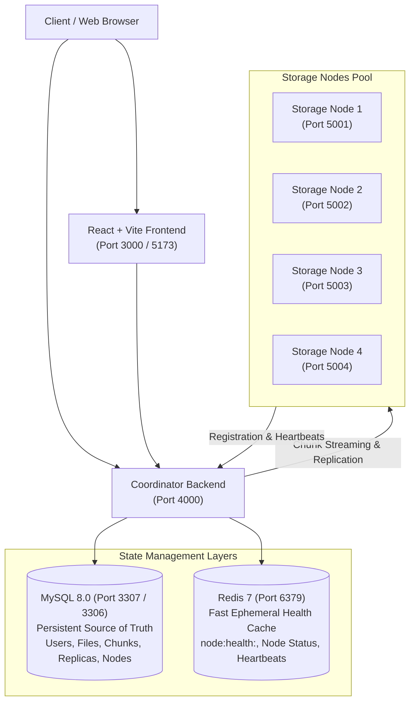

# Distributed File Storage System — Comprehensive System Guide & API Instructions

A complete, end-to-end guide for running, configuring, and testing the Distributed File Storage System across Docker, Frontend, Coordinator Backend, Storage Nodes, and all REST API endpoints.

---

## Table of Contents
1. [Architecture & Services Matrix](#1-architecture--services-matrix)
2. [Running with Docker Compose](#2-running-with-docker-compose)
3. [Running Locally (Bare Metal / Development)](#3-running-locally-bare-metal--development)
4. [Environment Variables Reference](#4-environment-variables-reference)
5. [Complete API Endpoints Reference](#5-complete-api-endpoints-reference)
   - [A. System Health & Infrastructure](#a-system-health--infrastructure)
   - [B. Authentication Subsystem](#b-authentication-subsystem)
   - [C. Storage-Node Management & Cluster State (Step 8)](#c-storage-node-management--cluster-state-step-8)
   - [D. File Upload, Chunking & Metadata (Steps 4 & 5)](#d-file-upload-chunking--metadata-steps-4--5)
   - [E. Replication & Streaming Download (Steps 6 & 7)](#e-replication--streaming-download-steps-6--7)
   - [F. Raw Storage-Node Binary Chunks API (Step 1)](#f-raw-storage-node-binary-chunks-api-step-1)
6. [Verification Scripts & Automated Tests](#6-verification-scripts--automated-tests)
7. [Troubleshooting & Common Issues](#7-troubleshooting--common-issues)

---

## 1. Architecture & Services Matrix



### Services & Port Allocation

| Service | Container Name | Host Port | Internal Port | Description |
|---|---|---|---|---|
| **Frontend** | `dfs-frontend` | `3000` | `80` | React Dashboard UI (Nginx in Docker, Vite on dev) |
| **Backend** | `dfs-backend` | `4000` | `4000` | Express Coordinator (Auth, Files, Chunks, Nodes) |
| **MySQL** | `dfs-mysql` | `3307` | `3306` | Persistent metadata storage |
| **Redis** | `dfs-redis` | `6379` | `6379` | Sub-millisecond node-health state cache |
| **Storage Node 1** | `dfs-storage-node-1` | `5001` | `5001` | Dedicated binary chunk server (Volume 1) |
| **Storage Node 2** | `dfs-storage-node-2` | `5002` | `5002` | Dedicated binary chunk server (Volume 2) |
| **Storage Node 3** | `dfs-storage-node-3` | `5003` | `5003` | Dedicated binary chunk server (Volume 3) |
| **Storage Node 4** | `dfs-storage-node-4` | `5004` | `5004` | Dedicated binary chunk server (Volume 4) |

---

## 2. Running with Docker Compose

### Start the Entire Cluster
```bash
# Build and start all 8 containers in the background
docker compose up -d --build
```

### Check Running Containers
```bash
docker compose ps
```

### View Logs
```bash
# Stream all logs
docker compose logs -f

# View logs for a specific service
docker compose logs -f backend
docker compose logs -f storage-node-1
docker compose logs -f frontend
```

### Stop the Cluster
```bash
# Stop containers (preserves database volumes)
docker compose down

# Stop and wipe database/storage volumes (fresh start)
docker compose down -v
```

---

## 3. Running Locally (Bare Metal / Development)

### Prerequisites
- Node.js 18+ (tested with Node 20 / 22)
- Running MySQL instance on port `3306` (or `3307`)
- Running Redis instance on port `6379`

### Step 1: Coordinator Backend
```powershell
cd backend
npm install
npm run build      # Compile TypeScript
npm run dev        # Starts server on http://localhost:4000
```

### Step 2: Storage Nodes (Run 4 instances)
Open separate terminals for each node:
```powershell
# Terminal 1: Storage Node 1
cd storage-node
$env:PORT="5001"; $env:NODE_ID="node-1"; npm run dev

# Terminal 2: Storage Node 2
cd storage-node
$env:PORT="5002"; $env:NODE_ID="node-2"; npm run dev

# Terminal 3: Storage Node 3
cd storage-node
$env:PORT="5003"; $env:NODE_ID="node-3"; npm run dev

# Terminal 4: Storage Node 4
cd storage-node
$env:PORT="5004"; $env:NODE_ID="node-4"; npm run dev
```

### Step 3: Frontend Web UI
```powershell
cd frontend
npm install
npm run build      # Test production build
npm run dev        # Starts Vite dev server on http://localhost:5173
```

---

## 4. Environment Variables Reference

### Backend (`backend/.env`)
```ini
PORT=4000
MYSQL_HOST=mysql         # use 'localhost' if running outside Docker
MYSQL_PORT=3306          # use '3307' if mapped to host port
MYSQL_USER=dfs_user
MYSQL_PASSWORD=dfs_password
MYSQL_DATABASE=distributed_file_storage

REDIS_HOST=redis         # use 'localhost' if outside Docker
REDIS_PORT=6379

JWT_SECRET=dfs_super_secret_jwt_key_2026
JWT_EXPIRES_IN=24h

CHUNK_SIZE=10485760      # 10 MB default chunk size
REPLICATION_FACTOR=2     # 2 copies stored per chunk
STORAGE_CONCURRENCY=4
STORAGE_NODE_TIMEOUT=5000

# Node Management & Heartbeat
HEARTBEAT_INTERVAL_MS=5000
HEARTBEAT_TIMEOUT_MS=15000
```

### Storage Node (`storage-node/.env`)
```ini
NODE_ID=node-1
PORT=5001
HOST=localhost
DATA_DIR=./data
BACKEND_URL=http://localhost:4000
HEARTBEAT_INTERVAL_MS=5000
```

### Frontend (`frontend/.env`)
```ini
VITE_API_URL=http://localhost:4000
```

---

## 5. Complete API Endpoints Reference

Base URL: `http://localhost:4000/api`

---

### A. System Health & Infrastructure

#### 1. Backend Health Check
- **Endpoint**: `GET /api/health`
- **Auth**: None
- **Description**: Returns status of coordinator and connections to MySQL and Redis.
- **Example Response**:
```json
{
  "status": "ok",
  "uptime": 128,
  "timestamp": "2026-10-05T14:00:00.000Z",
  "services": {
    "mysql": true,
    "redis": true
  }
}
```

#### 2. Storage Node Health Probe
- **Endpoint**: `GET http://localhost:5001/health`
- **Example Response**:
```json
{
  "nodeId": "node-1",
  "status": "ok",
  "uptime": 89,
  "timestamp": "2026-10-05T14:00:00.000Z",
  "dataDir": "/data"
}
```

#### 3. Storage Node Disk Stats
- **Endpoint**: `GET http://localhost:5001/stats`
- **Example Response**:
```json
{
  "nodeId": "node-1",
  "totalStorage": 107374182400,
  "usedStorage": 1048576,
  "availableStorage": 107373133824,
  "numberOfChunks": 1
}
```

---

### B. Authentication Subsystem

#### 1. User Registration
- **Endpoint**: `POST /api/auth/register`
- **Headers**: `Content-Type: application/json`
- **Request Body**:
```json
{
  "name": "Tosip Shaikh",
  "email": "user@example.com",
  "password": "Password123!"
}
```
- **Response (`201 Created`)**:
```json
{
  "message": "User registered successfully",
  "user": {
    "id": 1,
    "name": "Tosip Shaikh",
    "email": "user@example.com",
    "created_at": "2026-10-05T14:00:00.000Z"
  },
  "token": "eyJhbGciOiJIUzI1NiIsInR5cCI6IkpXVCJ9..."
}
```

#### 2. User Login
- **Endpoint**: `POST /api/auth/login`
- **Request Body**:
```json
{
  "email": "user@example.com",
  "password": "Password123!"
}
```
- **Response (`200 OK`)**:
```json
{
  "message": "Login successful",
  "user": {
    "id": 1,
    "name": "Tosip Shaikh",
    "email": "user@example.com"
  },
  "token": "eyJhbGciOiJIUzI1NiIsInR5cCI6IkpXVCJ9..."
}
```

#### 3. Get Current Profile
- **Endpoint**: `GET /api/auth/me`
- **Headers**: `Authorization: Bearer <TOKEN>`
- **Response (`200 OK`)**:
```json
{
  "user": {
    "id": 1,
    "name": "Tosip Shaikh",
    "email": "user@example.com"
  }
}
```

---

### C. Storage-Node Management & Cluster State (Step 8)

#### 1. Node Self-Registration
- **Endpoint**: `POST /api/nodes/register`
- **Description**: Called automatically by storage nodes on boot. Idempotent upsert prevents duplicates.
- **Request Body**:
```json
{
  "nodeId": "node-1",
  "host": "localhost",
  "port": 5001,
  "totalCapacity": 107374182400,
  "currentUsage": 1048576
}
```
- **Response (`200 OK`)**:
```json
{
  "success": true,
  "message": "Node 'node-1' registered successfully",
  "node": {
    "id": 1,
    "nodeId": "node-1",
    "host": "localhost",
    "port": 5001,
    "totalCapacity": 107374182400,
    "currentUsage": 1048576,
    "status": "HEALTHY",
    "lastHeartbeat": "2026-10-05T14:00:00.000Z"
  }
}
```

#### 2. Periodic Node Heartbeat
- **Endpoint**: `POST /api/nodes/heartbeat`
- **Description**: Storage nodes send heartbeats every 5 seconds. Updates MySQL and Redis fast state.
- **Request Body**:
```json
{
  "nodeId": "node-1",
  "currentUsage": 2097152,
  "totalCapacity": 107374182400,
  "status": "HEALTHY"
}
```
- **Response (`200 OK`)**:
```json
{
  "success": true,
  "message": "Heartbeat acknowledged",
  "nodeId": "node-1",
  "status": "HEALTHY",
  "timestamp": "2026-10-05T14:00:05.000Z"
}
```

#### 3. List All Nodes
- **Endpoint**: `GET /api/nodes`
- **Description**: Merges persistent MySQL metadata with live Redis state.
- **Response (`200 OK`)**:
```json
{
  "totalNodes": 4,
  "onlineNodes": 4,
  "count": 4,
  "nodes": [
    {
      "id": 1,
      "nodeId": "node-1",
      "host": "localhost",
      "port": 5001,
      "url": "http://localhost:5001",
      "totalCapacity": 107374182400,
      "currentUsage": 2097152,
      "status": "HEALTHY",
      "lastHeartbeat": "2026-10-05T14:00:05.000Z",
      "sourceOfTruth": "mysql",
      "liveState": "redis"
    }
  ]
}
```

#### 4. Get Node by ID
- **Endpoint**: `GET /api/nodes/:id` (Accepts string `node-1` or numeric `1`)
- **Response (`200 OK`)**: Returns single `node` object.

#### 5. Complete Cluster State
- **Endpoint**: `GET /api/nodes/cluster/state` (or `/api/nodes/cluster`)
- **Response (`200 OK`)**:
```json
{
  "cluster": {
    "status": "HEALTHY",
    "totalNodes": 4,
    "healthyNodes": 4,
    "unavailableNodes": 0,
    "failedNodes": 0,
    "totalCapacity": 429496729600,
    "currentUsage": 8388608,
    "availableCapacity": 429488340992,
    "replicationFactor": 2,
    "timestamp": "2026-10-05T14:00:00.000Z"
  },
  "nodes": [ ... ]
}
```

---

### D. File Upload, Chunking & Metadata (Steps 4 & 5)

#### 1. Upload File
- **Endpoint**: `POST /api/files/upload`
- **Headers**:
  - `Authorization: Bearer <TOKEN>`
  - `Content-Type: multipart/form-data`
- **Body**: `file` (binary form field)
- **Flow**:
  1. Streamed to coordinator temporary storage (`uploads-temp/`).
  2. Record created in MySQL (`files` table, `status='uploading'`).
  3. Chunking Engine splits file into 10MB chunks, computes SHA-256 hashes.
  4. Storage Coordinator places chunks across healthy nodes with `REPLICATION_FACTOR=2`.
  5. Chunks confirmed and recorded in `chunk_replicas`.
  6. Temporary file unlinked; status updated to `complete`.
- **Response (`201 Created`)**:
```json
{
  "message": "File uploaded, chunked, and distributed successfully",
  "file": {
    "id": 1,
    "filename": "dataset.zip",
    "size": 25165824,
    "chunkCount": 3,
    "status": "complete",
    "createdAt": "2026-10-05T14:00:00.000Z"
  },
  "chunks": [
    {
      "chunkId": "chunk-1a2b...",
      "sequenceNumber": 1,
      "size": 10485760,
      "hash": "e3b0c44298fc1c149afbf4c8996fb92427ae41e4649b934ca495991b7852b855"
    }
  ],
  "replication": {
    "factor": 2,
    "success": true
  }
}
```

#### 2. List Files
- **Endpoint**: `GET /api/files`
- **Headers**: `Authorization: Bearer <TOKEN>`
- **Response (`200 OK`)**: Array of file records belonging to the authenticated user.

#### 3. Get File Metadata
- **Endpoint**: `GET /api/files/:id`
- **Headers**: `Authorization: Bearer <TOKEN>`
- **Response (`200 OK`)**: File metadata, chunk count, and replica details.

---

### E. Replication & Streaming Download (Steps 6 & 7)

#### 1. Stream & Download Reconstructed File
- **Endpoint**: `GET /api/files/:id/download`
- **Headers**: `Authorization: Bearer <TOKEN>`
- **Response (`200 OK`)**:
  - `Content-Type: application/octet-stream`
  - `Content-Disposition: attachment; filename="dataset.zip"`
  - `Content-Length: <file size>`
- **Reliability & Failover Rules**:
  - Bounded memory ($O(1)$ RAM usage, streams chunk-by-chunk directly into HTTP response).
  - Verifies SHA-256 integrity hash of every chunk before streaming.
  - **Automatic Node Failover**: If primary replica is unreachable, automatically fetches from secondary replica.
  - **Automatic Corruption Failover**: If primary replica returns corrupted data (hash mismatch), automatically retrieves healthy replica copy.

#### 2. Delete File
- **Endpoint**: `DELETE /api/files/:id`
- **Headers**: `Authorization: Bearer <TOKEN>`
- **Response (`200 OK`)**: Removes file metadata and triggers chunk deletion on storage nodes.

---

### F. Raw Storage-Node Binary Chunks API (Step 1)

Used directly by Coordinator to store/retrieve chunks on individual nodes:

- `POST http://localhost:5001/chunks`
  - Headers: `x-chunk-id: <chunk-uuid>`, `Content-Type: application/octet-stream`
  - Body: Raw chunk bytes
- `GET http://localhost:5001/chunks/:chunkId`
  - Streams raw chunk bytes
- `DELETE http://localhost:5001/chunks/:chunkId`
  - Deletes chunk file from disk

---

## 6. Verification Scripts & Automated Tests

All tests and automated verification scripts are located in the [`test/`](file:///e:/Projects/distributed_file_storage/test) folder:

### 1. Run All Automated Jest Tests (32 Tests)
```powershell
cd backend
npm test
```
**Coverage**:
- `chunkService.test.ts`: Small files, exact chunk multiples, remainder partial chunks, temp file cleanup, atomic rollback.
- `storageCoordinator.test.ts`: Deterministic round-robin, node health filtering, timeout compensation, replica recording.
- `replicationAndDownload.test.ts`: Multi-node placement ($C_1 \rightarrow N_1+N_3$), offline failover, corrupted chunk hash failover, missing chunk handling.
- `storageNodeManagement.test.ts`: Node registration, heartbeat tracking, Redis vs MySQL state, stale heartbeat detection, cluster state calculation.

### 2. Verify Step 8 Subsystem
```powershell
.\test\verify8.bat
```

### 3. Check All Live Cluster Services (Steps 1 through 8)
```powershell
.\test\check-all-services.bat
```

---

## 7. Troubleshooting & Common Issues

| Problem | Cause | Solution |
|---|---|---|
| `Cannot connect to MySQL (ECONNREFUSED 3306)` | MySQL container is starting up or port collision | Check `docker compose ps`. Wait 20-30s for healthcheck to turn green. If running locally, check port `3306` vs `3307`. |
| `Cannot connect to Redis` | Redis container offline | Run `docker compose restart redis`. |
| `Node status shows UNAVAILABLE` | Node stopped sending heartbeats (> 15s) | Check node logs: `docker compose logs -f storage-node-1`. Verify `HEARTBEAT_INTERVAL_MS` is set to `5000`. |
| `Upload fails: Not enough healthy nodes` | Active healthy nodes < `REPLICATION_FACTOR` (2) | Ensure at least 2 storage nodes are running and reported healthy in `GET /api/nodes/cluster/state`. |
| `PowerShell script execution disabled` | Windows Execution Policy restriction | Run batch files (`.bat`), or use `powershell -ExecutionPolicy Bypass -File <script.ps1>`. |
